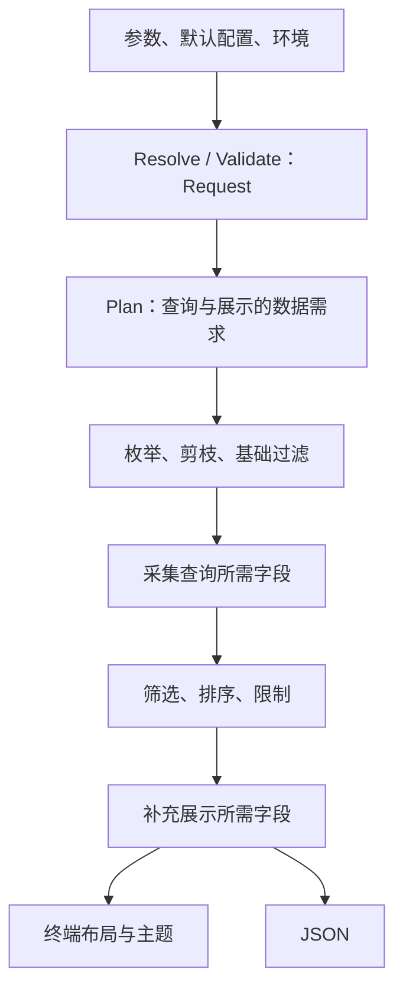

# 1.0 架构草稿

状态：设计建议。用户已确认不引入 preset/profile/场景模式；其余选型按当前任务和已接受决定推进。功能优先级见 [功能取舍表](feature-scope.md)，公共行为见 [行为契约](behavior-contract.md)。

## 1. 设计目标

1. `g [options] [paths...]` 仍是核心用法。
2. CLI、配置形成明确请求，每次 Run 的状态独立。
3. 原始文件数据与终端样式分开，机器输出直接使用原始类型。
4. 通过字段/过滤/排序需求决定读取成本，允许部分结果与可识别诊断。
5. 使用少量明确模块，逐条迁移真实调用链。

## 2. 执行流程



QueryNeeds 是筛选、排序、遍历所需能力；OutputNeeds 是最终输出字段所需能力。两者共享采集结果。过滤器需要 MIME 时不能提前跳过检测；仅展示 checksum 时可以先选出条目再计算。

这是一条明确执行流水线，不需要为少量内置能力实现通用 DAG 框架、运行时插件系统或依赖注入容器。

## 3. 数据结构示意

下列代码表达边界，不是已存在的可编译 API：

```go
type Request struct {
    Paths  []string
    Scan   ScanOptions
    Query  QueryOptions
    Output OutputOptions
}

type Plan struct {
    Request     Request
    QueryNeeds  MetadataNeeds
    OutputNeeds MetadataNeeds
}

type Entry struct {
    RootID     int
    Path       string
    Name       string
    ParentPath string
    Kind       EntryKind

    Stat    *StatInfo
    Link    *LinkInfo
    Git     *GitInfo
    Content *ContentInfo
}
```

实际模型还需表达元数据状态：未请求、不支持、失败、已取得；空指针本身不足以区分全部状态。使用显式状态或字段结果类型，在 schema 定案时完成映射。Entry 的路径字段含义写清，原始链接目标与解析后目标独立。

`Result` 至少组织多个输入根、条目、树关系和诊断。终端排版可以建立独立 Cell/Row；这些显示对象不能成为 JSON 的输入。

## 4. 模块边界

| 模块 | 所有权 |
| --- | --- |
| cli / config | RawOptions、显式设置标记、旧输入兼容转换 |
| app | Resolve、Validate、Plan、一次 Run 生命周期和退出码 |
| listing | Entry/Result、纯过滤排序和树关系 |
| scan | 枚举、遍历、按需求采集及并发预算 |
| fsmeta / git | 平台元数据和外部 Git 访问 |
| output / theme | 协议编码、终端布局、样式与输出错误 |
| shell | 初始化和补全生成 |

基础 `listing` 类型不导入具体采集器。平台/Git 适配器返回基础数据，app/scan 组装；output 消费结果。当前路径与迁移来源见 [重构基线](baseline.md#1-结构与执行路径)。

app 在生成 Request 前调用 `ValidateOptions`。选项定义通过规则表声明互斥组和前置条件；校验结果携带规则类别、涉及的选项、原始拼写和来源，交给 CLI 统一生成提示。新增同类冲突只需添加规则及对应的组合用例。行为示例见 [C01 选项组合校验](behavior-contract.md#选项组合校验)。

**提示文案维护。** CLI 按诊断类别维护模板。互斥用 `choose only one of: {used}`，前置条件用 `{used} requires one of: {choices}`。规则只引用行为 ID；已输入的选项从解析结果取原始拼写，待补的选项从命令定义取规范写法。每个互斥组按行为去重，只报告一次，实际拼写按输入顺序列出。只有修正方式无法从规则推导时，才为该规则附加一条可选提示，例如退役参数的替代命令。

模板测试检查少量完整输出；规则测试检查诊断类别和涉及的行为；别名归一测试覆盖等价入口。新增别名时只更新命令定义及映射用例。

## 5. 字段系统

内置字段定义维护稳定 ID、类型、数据需求、终端标题/对齐/格式化、可排序性。JSON 字段名与终端表头不相互推导。

例如 `--fields name,size,mtime` 是字段选择，普通用户配置可以设置默认字段。没有命名行为组合，也没有目录自动识别。

一个新字段的正常改动范围应是：数据定义、采集能力、字段声明、显示格式和行为测试。若需要同时修改 CLI 主循环、所有 printer、排序缓存和全局主题，应重新检查边界。

## 6. 查询顺序与输出形态

- 扫描得到名称/种类后，先处理能立即判断的过滤与明确剪枝。
- 对候选项收集 query 数据，再执行完整过滤、排序和 limit。
- 根据最终条目补齐仅输出需要的数据。
- 无排序且不需整体对齐的输出可以流式处理；排序、grid、表格对齐需要在对应作用域内收集。
- tree 展示祖先关系，排序/limit 的作用域必须在行为契约中定案，不能由 renderer 临时修改查询规则。
- 普通路径、链接目标和未来路径字节字段都必须可对应到同一个输入根。

## 7. 单次运行接口

```go
func Run(ctx context.Context, args []string, env Environment,
    stdout, stderr io.Writer) int
```

入口建立环境并退出；内部函数返回结果/错误。对测试而言，环境应能提供 cwd、必要 env、终端能力和可控时间。无需为所有 OS API 创建接口；真实临时目录与少量边界替身足够覆盖大部分行为。

运行期缓存和资源本次创建本次释放。兼容转换不进入领域规则。开发期比较旧/新引擎的机制在路线图指定阶段退出。

## 8. 技术选择与决定顺序

| 项目 | 草稿建议 | 决定依据 |
| --- | --- | --- |
| 语言 | 继续 Go | 复用项目和维护经验，先解决可见的数据流问题 |
| CLI parser | 先隔离现有 urfave/cli；pflag 是候选 | 用真实参数兼容 fixture 验证混排、短选项、旧别名再决定 |
| 配置 | YAML + typed struct + version | 将旧 Args 转为边界适配，保留显式值语义 |
| 文件 I/O | 标准库为主 | 能按请求选择分批读取/stat，减少隐含工作 |
| Git | 系统 Git 的稳定机器协议 | 复用准确的仓库语义，按仓库批量查询 |
| 终端 | 统一终端能力与宽度适配 | 可评估 x/term 和 x/ansi；不把它们散落到核心类型 |
| 输出 | 标准库 encoder + 专门路径 writer | 保持类型与分隔语义 |
| 发布 | 先改善现有 Actions/脚本 | 工具替换不作为新内核的前置条件 |

pflag 官方说明支持选项/位置参数混排与 `--`；这只支持把它列为候选，旧版单横杠长别名仍需单独判断。[pflag](https://github.com/spf13/pflag)

Git porcelain 和 `-z` 提供机器解析方式；解析器需要按指定版本处理重命名和 NUL 路径，而非拆行。[git-status](https://git-scm.com/docs/git-status)

终端相关候选文档：[x/term](https://pkg.go.dev/golang.org/x/term)、[x/ansi](https://pkg.go.dev/github.com/charmbracelet/x/ansi)。实际依赖版本在实施任务中固定，包内示例不指定未经验证的升级版本。

## 9. 第一条垂直链的验收

- [ ] 名称输出和 JSON 消费同一种 typed Entry。
- [ ] 同进程两次 Run 使用不同参数和 writer，结果互不污染。
- [ ] 多根、空目录和读取失败有明确结果。
- [ ] writer/Flush 失败向上返回。
- [ ] 主题不改变机器数据；查询与显示依赖可分别验证。
- [ ] 不引入全局运行容器、preset 或新的持久化数据库。

先用这条链验证架构，再按 [路线图](roadmap.md) 扩展。模块数量与文件移动量不作为完成指标。
